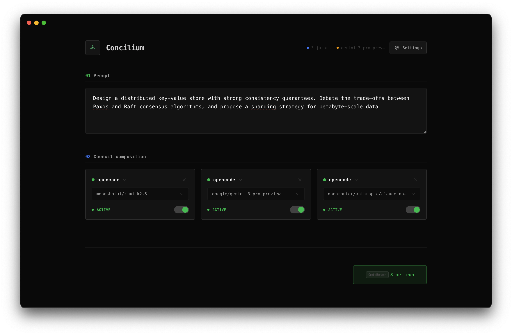

# Concilium

> Every model gives you a different answer. Get the right one.

Concilium is a multi-LLM deliberation platform that runs multiple AI coding agents in parallel, has them peer-review each other's responses anonymously, and synthesizes a single superior answer — from the terminal or as a desktop application.

[](https://opensource.org/licenses/MIT)
[](https://github.com/matiasdaloia/concilium)
[](https://github.com/matiasdaloia/concilium)



## The Problem

You already know one model isn't enough. So you open multiple terminals, paste the same prompt into Claude, OpenAI, and Codex, then spend 20 minutes reading and comparing their outputs. There has to be a better way.

**The old workflow:**
- Copy-paste the same prompt into 3 different tools
- Switch between browser tabs, terminals, and apps
- Read 3 long outputs and compare them manually
- Hope you picked the answer with the fewest bugs

**~25 minutes per prompt. High cognitive load. Error-prone.**

## The Solution

Concilium automates the entire process:

1. **Parallel Execution** — Send one prompt, three agents start working simultaneously
2. **Blind Peer Review** — Juror models evaluate and rank responses anonymously
3. **Synthesis** — A Chairman model combines the best parts into one validated answer

**~3 minutes per prompt. Fully automated. Peer-validated.**

## Features

- **Multi-Agent Execution** — Run Claude, OpenAI, and local models in parallel
- **Anonymous Peer Review** — Models critique each other without bias
- **Consensus-Based Ranking** — Objective scoring filters out hallucinations
- **Synthesized Output** — One answer that captures the best of all three
- **CLI and Desktop** — Full terminal interface or Electron GUI, your choice
- **Programmatic API** — `import { deliberate } from '@concilium/cli'` for agent skills and scripts
- **Local-First** — Your data stays on your machine
- **Open Source** — MIT licensed, fully transparent

## Getting Started

### Prerequisites

- Node.js 22+
- macOS 12+ (Apple Silicon or Intel) or Linux
- At least one coding agent CLI installed and signed in. Agents, jurors and the chairman all run through them, under your own login:
  - [Claude Code](https://docs.anthropic.com/en/docs/agents-and-tools/claude-code/overview)
  - [Codex](https://github.com/openai/codex) (OpenAI)
  - [Gemini CLI](https://github.com/google-gemini/gemini-cli)
  - [OpenCode](https://github.com/sst/opencode)
- Optional: an [OpenRouter](https://openrouter.ai/) API key, only if you want OpenRouter models as jurors or chairman

### Installation (users)

Install the CLI globally from npm:

```bash
npm install -g @concilium/cli
```

Then check your agent CLIs and run (no API key needed):

```bash
concilium doctor                # which agent CLIs are installed and signed in
concilium run --agents claude,codex,gemini "Refactor the auth module to use JWT tokens"
```

### Development (contributors)

Clone and build from source:

```bash
git clone https://github.com/matiasdaloia/concilium.git
cd concilium
npm install
npm run build        # builds core, then CLI (in order)
```

Run the CLI in dev mode (uses `tsx`, no build step needed):

```bash
npm run dev -w @concilium/cli -- run "your prompt"
```

Optionally, for OpenRouter jurors or chairman, configure an API key:

```bash
npx concilium config set api-key sk-or-...
```

**Desktop (alternative):** Create a `.env` file in the `desktop/` directory:
```bash
echo "OPENROUTER_API_KEY=sk-or-..." > desktop/.env
```

Or set `OPENROUTER_API_KEY` as an environment variable — it takes priority everywhere.

Launch the desktop GUI:

```bash
npm run start -w concilium     # opens the Electron desktop app
```

> See the [CLI documentation](packages/cli/README.md) for the full command reference.

## CLI

Concilium ships a full-featured terminal interface alongside the desktop app. Run deliberations, manage configuration, browse history, and discover models — all from the command line.

### Quick examples

```bash
# Basic deliberation (agents: the installed, signed-in agent CLIs)
concilium run "Add input validation to the user registration endpoint"

# Read prompt from a file
concilium run -f prompt.md

# Pick specific agents and models
concilium run --agents claude,codex,gemini,opencode "Fix the race condition in the worker pool"

# Custom jurors and chairman (agent CLIs, or OpenRouter model IDs with an API key)
concilium run --juror-models claude:opus,codex \
              --chairman gemini \
              "Design a rate limiter"

# JSON output for scripting
concilium run --json "Explain the auth flow" | jq '.stage3.response'

# Save synthesis to a file
concilium run --output solution.md "Migrate the database schema"
```

### Commands

| Command | Description |
|---------|-------------|
| `concilium run <prompt>` | Run a deliberation pipeline |
| `concilium code <task>` | Have agent CLIs write code, each in its own worktree and `concilium/` branch, then run the repo's gates and integrity checks on each against the base, and the tests each model family's adversary writes against the others, then rank them on that evidence, with a judge from another model family only for exact ties |
| `concilium history` | List past runs |
| `concilium history <id>` | View a specific run |
| `concilium history --last --synthesis` | Print the last synthesis |
| `concilium config show` | Show current configuration |
| `concilium config set api-key` | Set the optional OpenRouter API key |
| `concilium config set chairman <model>` | Set the chairman (`gemini`, `claude:opus`, or an OpenRouter ID) |
| `concilium config set jurors <m1,m2,...>` | Set the jurors |
| `concilium config set <role> <members>` | Save who plays a code-council role (`planner`, `implementer`, `adversary`, `judge`, `integrator`) or the PR `verifier`, e.g. `judge codex:gpt-5.2` |
| `concilium roles` | Show who plays each role (from `--role`, `.concilium/factory.yaml`, saved config or detection), where it was set, and any broken role rule (a judge that can judge only its own family, a verifier of an author family, unless you opt in with `allow-same-family-verifier`), which stops `code`, `factory`, `pr` and `verify-pr` before any agent CLI runs |
| `concilium models` | Discover available agent models |
| `concilium models --council` | List OpenRouter models for jurors |
| `concilium doctor` | Check which agent CLIs are installed and how they sign in |
| `concilium gc` | Remove worktrees and `concilium/` branches of finished runs |
| `concilium trail check --run <id>` | Check a code run's `decisions.tsv` against its event log and resolve every row's evidence |
| `concilium gates` | List the actions Concilium paused for your approval (push, pull requests, writes outside `concilium/`) |
| `concilium approve <gate-id>` | Approve one paused action and run its exact command |
| `concilium reject <gate-id>` | Reject one paused action; it never runs |
| `concilium pr <run-id>` | Verify the commit a code run would ship (its integration branch without the trail commit, or its only candidate), then pause a push of exactly that SHA and a pull request for approval; same-family verification forces a draft |
| `concilium verify-pr <run-id>` | Re-run a code run's gates and adversarial tests at that commit with a non-author family (an author family, flagged, only when no other is usable or with `--allow-same-family-verifier`), and record the verdict |
| `concilium status <run-id>` | Show a code run's gates and verdict; the verdict is void once the branch head moved. Given a factory id, show the factory's tasks, runs and verdicts |
| `concilium factory <spec>` | Have the planner split a spec file into typed tasks with acceptance lines and dependencies, then run one verified code run per task in dependency order, each on the commit the one before it shipped; stops at the first task that does not ship, and pushes nothing |
| `concilium stats` | Show the learning ledger of the repo's code runs: each implementer's win rate (picked as the base) by task type and runner, the other roles' outcomes, and a candidate set per task type once it has enough runs, always of two model families or more |

For detailed usage, flags, configuration, and the programmatic API, see the **[CLI documentation](packages/cli/README.md)**.

## Architecture

Concilium uses a three-stage consensus protocol:

```
┌─────────────────┐     ┌─────────────────┐     ┌─────────────────┐
│  Stage 1:       │     │  Stage 2:       │     │  Stage 3:       │
│  Parallel       │ ──► │  Blind          │ ──► │  Synthesis      │
│  Execution      │     │  Review         │     │                 │
└─────────────────┘     └─────────────────┘     └─────────────────┘
        │                       │                       │
        ▼                       ▼                       ▼
   ┌─────────┐            ┌─────────┐            ┌─────────┐
   │ Claude  │            │ Juror 1 │            │         │
   │ Codex   │            │ Juror 2 │            │ Chairman│
   │ Gemini  │            │ Juror N │            │         │
   │ OpenCode│            │         │            │         │
   └─────────┘            └─────────┘            └─────────┘
        │                       │                       │
        └───────────────────────┴───────────────────────┘
                              │
                              ▼
                    ┌─────────────────┐
                    │  Final Answer   │
                    │  (Validated)    │
                    └─────────────────┘
```

## Repository Structure

```
concilium/
├── packages/
│   ├── core/             # @concilium/core — domain logic, ports, adapters
│   │   ├── src/
│   │   │   ├── domain/   # Agent, council, deliberation, run types & logic
│   │   │   ├── ports/    # Interfaces (HeadlessCliDriver, LlmGateway, etc.)
│   │   │   ├── adapters/ # Agent CLI drivers, CLI council gateway, OpenRouter, JSON storage
│   │   │   ├── services/ # DeliberationService, ConfigService
│   │   │   └── shared/   # Logger
│   │   └── package.json
│   └── cli/              # @concilium/cli — terminal interface
│       ├── bin/          # Entry point (concilium command)
│       ├── src/
│       │   ├── commands/ # run, code, history, config, models, doctor, roles, gc
│       │   ├── ui/       # Ink (React) terminal components
│       │   ├── adapters/ # XDG paths, callback event bridge
│       │   └── formatters/
│       └── package.json
├── desktop/              # Electron desktop application
│   ├── src/
│   │   ├── main/         # Main process + Electron-specific adapters
│   │   ├── preload/      # Preload scripts
│   │   └── renderer/     # React frontend
│   └── package.json
├── website/              # Astro marketing website
└── assets/               # Shared assets (logos, icons)
```

## Voice Dictation

Concilium includes offline voice dictation powered by [Whisper](https://github.com/openai/whisper). Speak your prompts instead of typing them.

### Setup

Voice dictation requires a one-time setup to download the Whisper model and build the binary:

```bash
cd desktop

# Download the Whisper model (~150MB)
npx nodejs-whisper download

# Build whisper.cpp
cd node_modules/nodejs-whisper/cpp/whisper.cpp
cmake -B build -DGGML_CUDA=OFF
cmake --build build --config Release
```

### Requirements

- **ffmpeg** (recommended): For audio format conversion
  ```bash
  # macOS
  brew install ffmpeg
  
  # Ubuntu/Debian
  sudo apt install ffmpeg
  ```

### Usage

1. Click the **Dictate** button next to the prompt input
2. Speak your prompt
3. Click **Stop** when finished
4. Wait 2-3 seconds for transcription
5. Your text appears in the prompt field

Voice dictation runs **completely offline** — your audio never leaves your machine.

## Development

All packages are managed as an npm workspace from the repo root.

```bash
npm install          # Install all workspace dependencies
```

### Building

Core must be built before the CLI, since `@concilium/cli` depends on `@concilium/core`:

```bash
npm run build                           # Builds core, then CLI (in order)
```

Or build individually:

```bash
npm run build -w @concilium/core        # Build core first
npm run build -w @concilium/cli         # Then build CLI
```

### CLI (dev mode)

```bash
npm run dev -w @concilium/cli -- run "your prompt"   # Dev mode with tsx (no build needed)
npx concilium run "your prompt"                      # Run from workspace (needs build)
```

### Publishing

```bash
npm run publish:core        # Publish @concilium/core to npm
npm run publish:cli         # Publish @concilium/cli to npm
npm run publish:all         # Publish both (core first)
```

### Desktop App

```bash
npm run start -w concilium              # Start Electron dev server
npm run package -w concilium            # Package the app
npm run make -w concilium               # Create distributables
npm run test -w concilium               # Run desktop tests
```

### Website

```bash
npm run dev -w concilium-website        # Start dev server
npm run build -w concilium-website      # Build for production
```

## Contributing

We welcome contributions! Please see our [Contributing Guide](CONTRIBUTING.md) for details.

1. Fork the repository
2. Create your feature branch (`git checkout -b feature/amazing-feature`)
3. Commit your changes (`git commit -m 'Add some amazing feature'`)
4. Push to the branch (`git push origin feature/amazing-feature`)
5. Open a Pull Request

## License

This project is licensed under the MIT License — see the [LICENSE](LICENSE) file for details.

## Acknowledgments

- Built with [Electron](https://www.electronjs.org/), [React](https://react.dev/), and [TypeScript](https://www.typescriptlang.org/)
- CLI powered by [Commander.js](https://github.com/tj/commander.js) and [Ink](https://github.com/vadimdemedes/ink) (React for terminals)
- LLM routing via [OpenRouter](https://openrouter.ai/)
- Website powered by [Astro](https://astro.build/) and [Tailwind CSS](https://tailwindcss.com/)
- 3D visuals using [React Three Fiber](https://docs.pmnd.rs/react-three-fiber)

---

<p align="center">
  Made with ❤️ by <a href="https://github.com/matiasdaloia">Matias Daloia</a>
</p>
