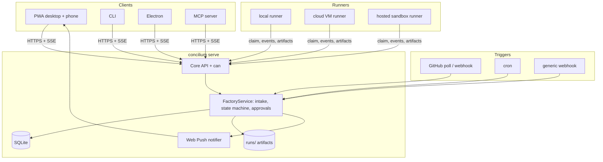
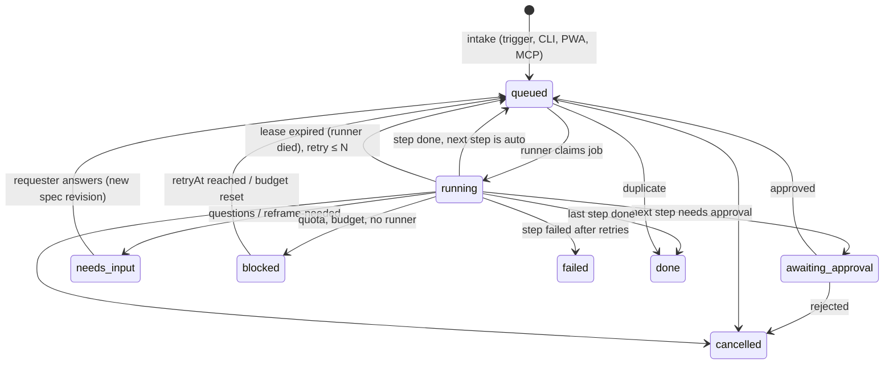

# Concilium factory architecture: control plane, runners, clients, config

Status: draft for review. Written 2026-10-16 on branch `plan/factory-layer3`. Planning only. Nothing here is implemented.

This document extends [factory-layer3.md](./factory-layer3.md). That plan (M0 to M9) turns Concilium into a code council: candidates write code in worktrees, evidence ranks them, and an integrator synthesizes one verified patch. This document answers the next question: how does the council become a factory that runs work from many triggers, on the user's workstation or on cloud machines, with approvals from a phone, and later inside an organization?

Prior art comes from [software-factory-landscape.md](../research/software-factory-landscape.md), cited below as `[R§n]` for the numbered setup or section in that file.

## How to read this

- Section 0 states the value proposition and the design rules, including what was cut.
- Section 1 is the architecture: one process, a runner protocol, clients, the work-item state machine.
- Section 2 covers subscription auth on remote runners and secret handling.
- Section 3 covers org mode.
- Section 4 is the per-repo `factory.yaml`.
- Section 5 is the milestone list M10 to M14, in four phases, each ending in a gate with exit criteria. Then risks and open questions.

---

## 0. Value proposition and design rules

### 0.1 Value proposition: evidence over faith

Most published factories run one implementer and one reviewer and trust the reviewer [R§2.5]. Concilium's bet is different.

1. **Cross-family competition with adversarial cross-verification.** Two to four candidates from different model families (Claude, GPT, Gemini, others) solve the same task in separate worktrees. Each family writes tests that attack the others. Gates and survival rates rank them before any LLM opinion is read (layer 3, B6).
2. **Dissent is a signal.** When candidates or judges disagree in a way the evidence cannot settle, the factory stops and surfaces the disagreement as concrete questions (`reframe-needed`, B7.6). It never averages two readings of a spec into one patch.
3. **Human review proportional to uncertainty.** Convergent candidates, all gates green, no open dissent, low-risk paths: the human sees a short summary and approves from a phone. Divergence, open dissent, or risky paths: the human gets the questions, the matrix and the diffs. Review effort follows the evidence, not a fixed ceremony. The bottleneck in every large factory is review [R§2.13], so this is where Concilium spends its design budget.
4. **A personal model leaderboard.** Every run records which runner won which task type in which repo, on evidence (layer 3, M8.2). After a few weeks the user knows which model to trust for what in their own code, not on a public benchmark.
5. **Provenance as evidence (optional).** A SCANOSS scan of the synthesized diff (snippet matches, licenses) is one more check in the evidence pack. It is configured as a command check, not built into core (Section 3.4, layer 3 F8).

### 0.2 Design rules

The overriding rule is: robust, and as simple as possible. Two pstack principles drive it (read from `~/.claude/plugins/cache/pstack-claude/pstack/0.9.34/skills/`). The Laziness Protocol (`principle-laziness-protocol`) says to prefer deletion, keep the call hierarchy flat, consolidate each decision in one place, and question every new signal threaded through layers. Subtract Before You Add (`principle-subtract-before-you-add`) says to remove first and design for observed usage, not speculative edge cases. Applied here:

1. **One process, one package.** `concilium serve` is the control plane, the HTTP API, the static PWA host and, by default, the local runner. It is the same npm package as the CLI. There is no separate service to deploy for v1.
2. **One database file.** Control-plane state (work items, events, jobs, users, approvals) lives in one SQLite file through Node's built-in `node:sqlite` (Node 24 is the dev runtime, A6). Run artifacts stay as plain directories in the layer 3 layout (B9). Plan-council runs stay in the existing `JsonRunRepository`.
3. **Design for v1 scope, build in gated order.** Cloud runners, the PWA and SSO are in v1 scope. Three seams exist from day one so none of them needs a rewrite later:
   - The local runner speaks the same runner protocol as a cloud runner, over loopback HTTP. A cloud runner is the same code on another machine.
   - Every interaction goes through one core API. The CLI, the PWA and the Electron app are clients of it.
   - Users and permissions exist in the data model from the first migration. v1 has one user. OIDC later adds another way to obtain a session for a user who already has a row.
4. **Reuse before adding.** The runner executes the layer 3 code council (`HeadlessAgent`, `WorkspaceManager`, `GateRunner`, `RunStore`, `ActionGate`). The control plane does not reimplement any of it.
5. **Pull, not push.** Runners poll the control plane over outbound HTTPS. No inbound ports on workstations or VMs, no message broker, no service discovery.
6. **Config narrows, code guards.** `factory.yaml` can make autonomy stricter. The never-auto list is code and cannot be loosened by config (layer 3, B10).

### 0.3 What was deliberately cut

Each cut names what would bring it back. None of these is needed to reach the phase gates in Section 5.

| Cut | Instead | Revisit when |
|---|---|---|
| Separate control-plane service, microservices | One `concilium serve` process | One process cannot keep up with an org's queue (measure first) |
| Postgres, Redis, NATS, Kafka, Temporal | SQLite (WAL mode) and HTTP polling | Org mode needs more than one control-plane instance |
| WebSockets, gRPC | HTTP JSON plus Server-Sent Events for live updates | Never, unless SSE proves insufficient on mobile |
| Kubernetes, runner autoscaling, VM provisioning API | The user starts a runner (a VM, a container, a sandbox) and it connects | Idle VM cost becomes a measured problem |
| Separate web dashboard app | The org dashboard is a PWA view | — |
| Native iOS and Android apps | PWA with Web Push (iOS supports push for installed PWAs) | Push or background limits block a real workflow |
| Building our own auth server | Personal tokens and device pairing in v1, then delegate to OIDC providers | — |
| Embedding-based dedup | Dedup by source reference (same issue, same PR, same alert id) | Duplicate work from different sources is observed |
| `WORKFLOW.md` prose prompts with Liquid templates [R§1] | Playbooks stay in core (layer 3, C1). `factory.yaml` selects them | Users need per-repo playbook text (add a `playbooks/` override dir, not a template engine) |
| Generic DAG pipeline engine [R§3] | Fixed work-item steps, plus the stacked sequential tasks of M8.1 | Real specs need parallel task DAGs (`blocked_by` dispatch, as Symphony does) |
| Plugin system | Adapters are code in core behind ports. Org-specific behavior is config and playbooks | Third parties want to ship adapters |
| Separate `.concilium/verify.yaml` and `roles.yaml` (layer 3, B6 and C4) | Folded into `factory.yaml` as `checks:` and `roles:` | — |
| OpenTelemetry in core | Events table plus structured logs. An optional OTLP exporter reads the events table | An org needs traces in its own backend |
| Building a tunnel for phone access to a laptop | Document Tailscale or Cloudflare Tunnel | — |
| New orchestration in Electron | Electron becomes a client, then probably retires (F4) | — |

---

## 1. Architecture

### 1.1 Shape

```
                ┌──────────────────────────── clients ─────────────────────────────┐
                │  PWA (desktop + phone, Web Push)   CLI (`concilium …`)   Electron  │
                │  MCP server (`concilium mcp`)      triggers (GitHub, cron, hooks)  │
                └───────────────┬──────────────────────────────────────────────────┘
                                │  HTTPS JSON + SSE   (one core API, token auth)
┌───────────────────────────────▼──────────────────────────────────────────────────┐
│ concilium serve  (control plane, one Node process)                               │
│                                                                                  │
│  API router ─► can(user, action, repo) ─► FactoryService                        │
│                                             │                                    │
│   triggers ─► intake/dedup ─► work items ──► state machine ─► jobs queue         │
│                                  │                │              │               │
│                         approvals + notifier   events (append-only, SSE)        │
│                                                                                  │
│  SQLite: users · memberships · tokens · repos · work_items · jobs · events ·     │
│          approvals · runners · push_subscriptions                                │
│  Files:  runs/<run-id>/… (layer 3 B9 layout)      static PWA bundle              │
│                                                                                  │
│  embedded local runner (optional, on by default) ─── loopback HTTP ──┐           │
└──────────────────────────────────────────────────────────────────────┼───────────┘
                    ▲ runner protocol (outbound HTTPS, long-poll)      │
       ┌────────────┴───────────────┬───────────────────────────┐      │
┌──────┴───────────┐   ┌────────────┴──────────┐   ┌────────────┴──────▼──┐
│ runner: cloud VM │   │ runner: hosted sandbox │   │ runner: workstation  │
│ (Fly, Hetzner)   │   │ (Modal, E2B, Daytona…) │   │ (the embedded one,   │
│ docker image     │   │ same image             │   │  or `concilium runner`)│
└──────────────────┘   └────────────────────────┘   └──────────────────────┘
   each runner = `concilium runner`: claim job → run layer 3 code council in a
   worktree (B4) with the user's CLIs (B5) → stream events → upload artifacts
```

The same picture as mermaid:



### 1.2 Where it runs

`concilium serve` runs in one of three places. The code is the same in all three.

| Deployment | Typical use | Reaching it from a phone |
|---|---|---|
| The user's workstation | Solo, first phases | Tailscale or Cloudflare Tunnel in front of `localhost` |
| A small VPS | Solo with laptop closed, small team | TLS through a reverse proxy (Caddy) |
| Self-hosted inside an org | Org mode | The org's ingress and OIDC provider |

If the control plane is on a VPS and the user wants work to run on their workstation, the workstation runs `concilium runner` and connects outbound. Local versus cloud is a runner choice, nothing else.

### 1.3 What is reused from Concilium and layer 3

| Existing or planned piece | Role in the factory |
|---|---|
| `createConciliumRuntime` composition root (layer 3, M0.4) | Used by `serve`, `runner` and the CLI. One place builds adapters |
| `HeadlessAgent` and the four CLI adapters (M1) | What a runner executes. `probe()` output is the runner's advertised capabilities |
| `concilium doctor` (M1.1) | Runs on each runner at registration. Results appear in the PWA runner list |
| `WorkspaceManager`, `GateRunner`, `RunStore` (M2, M4) | Unchanged. They run on the runner |
| Run directory layout (B9) | The artifact format. Runners upload it; the control plane serves it |
| Typed event union replacing `DeliberationEvents` (A8) | Becomes the `events` table payload and the SSE stream |
| `ActionGate` and the pause list (B10, M7.1) | A pause becomes the `awaiting_approval` state of a work item. `gates.md` plus `concilium approve` become an approvals row plus an API call. The CLI command keeps its name |
| `SecretStore` port | Encrypts tracker and repo tokens at rest in the control plane |
| `ConfigStore` (user level) | Holds user-level prefs. Per-repo factory config is `factory.yaml` |
| Learning ledger (M8.2) | The leaderboard view and routing suggestions |
| Plan council (Stages 1 to 3) | The `spec` step of a work item (M8.1) |
| Desktop React components (React 19, Tailwind 4) | Source of reusable components for the PWA |

### 1.4 The work item and its state machine

A work item is one request ("fix issue #42", "nightly dependency bump", "the feature described in this spec"). A job is one unit of execution on one runner. A work item moves through fixed steps. Each step runs as one job, or is skipped by the playbook.

Steps: `triage → spec → code → publish`.

- `triage` classifies (type, risk, size, actionable) and dedups. It can end the item with questions. Skipped when the trigger already carries a type (a label, a CLI flag).
- `spec` writes or refines the spec and acceptance lines, through the plan council. Required only for types the config marks `spec_required`.
- `code` is the layer 3 code council (M2 to M6). Its output is a verified integration branch or `reframe-needed`.
- `publish` pushes the branch and opens a draft PR, then runs the independent verifier (M7.2). Merging is a separate approval.

The state is one discriminated union, stored as a JSON column plus an indexed `kind` column:

```ts
type Step = 'triage' | 'spec' | 'code' | 'publish' | 'merge';

type WorkItemState =
  | { kind: 'queued'; step: Step }                               // waiting for a runner
  | { kind: 'running'; step: Step; jobId: string; runnerId: string }
  | { kind: 'awaiting_approval'; step: Step; approvalId: string } // a gate from autonomy config
  | { kind: 'needs_input'; step: Step; questions: string[] }      // triage questions or reframe-needed
  | { kind: 'blocked'; step: Step; reason: 'quota' | 'no_runner' | 'budget'; retryAt?: string }
  | { kind: 'done'; outcome: 'merged' | 'pr_open' | 'patch_ready' | 'decision' | 'duplicate' }
  | { kind: 'failed'; step: Step; reason: string }
  | { kind: 'cancelled'; by: string };

interface WorkItem {
  id: string;
  repoId: string;
  requesterId: string;              // a users row, from day one
  source: { kind: string; ref: string }; // e.g. github-issue / owner/repo#42; unique per repo (dedup key)
  title: string;
  type?: TaskType;                  // layer 3 B2
  risk?: 'low' | 'medium' | 'high';
  configSha: string;                // the factory.yaml snapshot this item runs under
  state: WorkItemState;
  createdAt: string;
}
```



Rules:

- **One transition function.** `transition(item, event, config) → WorkItemState` is a pure function in core, unit-tested per edge. The control plane persists its result and the event in one SQLite transaction. No other code writes `state`.
- **Approvals are just a state.** The autonomy config (Section 4) decides, per step boundary, whether the next step is `auto`, `notify` (proceed and push a notification) or `approve` (enter `awaiting_approval`). The never-auto list from B10 always yields `approve`.
- **Idempotent intake.** `(repoId, source.kind, source.ref)` is unique. A second trigger for the same issue appends an event to the existing item ("+1 voice", [R§6]) instead of creating new work.
- **Config is frozen per item.** The item records the `factory.yaml` SHA it started under, the same way layer 3 freezes the rubric (M3.2). Hot reload affects new items only.
- **Crash recovery.** On start, `serve` re-reads every `running` item. Each has a job lease. An expired lease puts the item back to `queued` with an attempt counter. Workspaces are recovered by `concilium gc` on the runner (M2.1).

Continuity across devices falls out of this. A user files a task from the phone, approves the spec on the phone, and opens the evidence on the desktop. Every screen renders the same item from the same API.

### 1.5 The core API

The API is a typed route table in core (`packages/core/src/api/`). Each route has a zod schema for input and output, a permission action, and a handler that calls `FactoryService`. `serve` mounts the table on `node:http`. The CLI and the PWA get a typed client generated from the same table. There is one transport (HTTP). The CLI does not get a second in-process code path.

```
POST   /api/items                  create a work item (CLI `concilium submit`, PWA, MCP)
GET    /api/items?state=&repo=     list
GET    /api/items/:id              item + state + steps + latest evidence summary
POST   /api/items/:id/answer       answer needs_input questions
POST   /api/items/:id/cancel
GET    /api/approvals?mine=1       pending approvals for this user
POST   /api/approvals/:id          { decision: 'approve' | 'reject', note }
GET    /api/runs/:runId/files/*    artifacts (synthesis.md, matrix.json, diffs, logs)
GET    /api/events?since=<seq>     SSE stream; clients resume from the last seq they saw
GET    /api/repos  POST /api/repos register a repo (local path or git URL)
GET    /api/runners                runners + capabilities + last heartbeat
GET    /api/stats                  leaderboard, cost, throughput
POST   /api/push/subscribe         Web Push subscription for this device
POST   /api/hooks/:source          inbound webhooks (signature-checked per source)
/runner/*                          the runner protocol (Section 1.6), runner tokens only
```

Every handler calls `can(user, action, repoId)` before anything else. In v1 the single owner passes every check, but the call sites exist, so org mode only changes the function and the data, not the handlers.

Authentication in v1 has two token kinds, both random, stored hashed:

- **User tokens.** `concilium token create` for the CLI. `concilium pair` prints a URL and QR code with a one-time code. The PWA exchanges it for a device token. Tokens can be listed and revoked.
- **Runner tokens.** `concilium runner register` issues one, bound to an owner user (Section 2).

### 1.6 The runner protocol

Runners pull. All calls are HTTPS from runner to control plane, authenticated with a runner token. The embedded local runner uses the same calls over `127.0.0.1`.

```
POST /runner/register        { name, labels, capabilities }          → { runnerId }
       capabilities = concilium doctor output: CLIs, versions, auth status per CLI,
       sandbox kinds (worktree | docker | microvm), os, arch, max_concurrency
POST /runner/claim           { runnerId, free_slots }  (long-poll ≤ 30 s)
                                                                       → { job } | 204
       job = { jobId, leaseToken, leaseExpiresAt, itemId, step,
               repo: { url, ref, localPath? }, brief, configSnapshot,
               credentials: [{ kind, scope, value, expiresAt }] }      // job-scoped only, see 2.3
POST /runner/jobs/:id/events     { leaseToken, seq, events[] }          → { cancel: boolean }
       batched typed events; seq makes retries idempotent; the reply carries cancellation
POST /runner/jobs/:id/heartbeat  { leaseToken }                         → { leaseExpiresAt, cancel }
PUT  /runner/jobs/:id/artifacts  { leaseToken } + tar.zst of runs/<run-id>/ (B9 layout)
POST /runner/jobs/:id/complete   { leaseToken, result: WorkerReport-shaped step result }
```

Properties that keep this simple and robust:

- **Leases, not locks.** A claim gives a lease of a few minutes, renewed by heartbeat. A runner that disappears loses the lease and the item returns to `queued`. A late `complete` with a stale lease token is rejected.
- **At-least-once, idempotent.** Event batches carry a sequence number and are deduped by `(jobId, seq)`. Artifact upload replaces the job's artifact set. `complete` is idempotent per lease.
- **Routing by labels.** A job carries `requires` (for example `cli:codex`, `sandbox:docker`, `owner:<userId>`). A runner claims only jobs whose requirements are a subset of its labels. That is the whole scheduler: a filtered `SELECT … ORDER BY created_at LIMIT 1` inside a transaction.
- **The runner owns execution, the control plane owns state.** The runner runs the layer 3 council for the step and reports. It never changes work-item state itself.
- **Approvals do not hold runners.** When a step ends and the next step needs approval, the job completes and the runner is free. The approved next step is a new job, possibly on another runner. A `publish` job re-creates the worktree from the uploaded integration branch bundle (`git bundle` in the artifacts), so it does not depend on the first runner still existing.

### 1.7 Clients

- **PWA** (`packages/web`, Vite plus React, served as static files by `serve`). Installable on desktop and phone. Screens: inbox (pending approvals and questions first), item detail (state, evidence summary, dissent at the top, diff viewer, matrix), new task, runners, stats. Web Push through VAPID keys generated at first start. A push for an approval deep-links to the item. Approve and reject work from the notification view.
- **CLI.** Existing commands keep working. New commands are API clients: `concilium serve`, `submit`, `status`, `approve`, `logs`, `pair`, `token`, `runner`. `concilium code` (layer 3, M2.2) remains the direct, server-less way to run one council locally. It is the same function the runner calls.
- **Electron.** Stops growing orchestration. Short term it points a window at the PWA served by a local `serve` and keeps the existing plan-council screens. Long term the installed PWA likely replaces it (F4).
- **MCP server.** `concilium mcp` exposes `submit`, `status`, `answer` as tools, so another agent can file work. It is an API client with a user token.
- **Native iOS.** Deferred (Section 0.3).

---

## 2. Subscription auth on remote runners

### 2.1 The rule

Subscriptions are personal. A Claude, ChatGPT or Gemini subscription belongs to one person and serves that person's own work. Concilium never pools subscriptions and never lets one user's login serve another user's work items. Users without a subscription, including non-technical users in an org, bring their own API key or pay for their own VMs and tokens.

This rule is enforced in the data model, not in documentation:

- Every runner has an `owner_user_id`.
- Every CLI credential on a runner is recorded as `(runner, cli, auth_kind: subscription | api_key, owner)`.
- A job that would use a `subscription` credential gets the requirement `owner:<requesterId>`. Only runners owned by the requester can claim it.
- Shared org runners (Section 3) may only run CLIs whose `auth_kind` is `api_key` with a key owned by the org.

Whether scripted, multi-process, remote use of consumer subscriptions is allowed by each provider's terms is an **open decision** (layer 3, F3; Section 5.8 Q1). It must be checked against primary sources before M12.3 ships. Until then cloud runners are documented as "your machine, your login, your work only", and API-key mode is the documented fallback.

### 2.2 Getting each CLI logged in on a remote runner

Credentials are created by the user, on the runner, and stay on the runner. The control plane never stores subscription credentials and never sends them in a job. It only knows the result of `concilium doctor` ("claude-code: logged in, subscription").

| CLI | Headless login on a remote machine (verify each in the M1.1 probe and M12.3) |
|---|---|
| Claude Code | On a machine with a browser, run `claude setup-token`. It prints a long-lived OAuth token for the subscription. Store it on the runner as `CLAUDE_CODE_OAUTH_TOKEN`. Sandcastle uses this path for subscription runs [R§4]. |
| Codex CLI | Sign in with ChatGPT. On a headless VM, use the device-code login if the installed version has one, or log in locally and copy the resulting `~/.codex/auth.json` to the runner. API-key mode is the fallback. |
| Gemini CLI | Sign in with Google. The cached OAuth credentials live under `~/.gemini/`. Log in through the device or browser flow on the runner, or copy the cache. `GEMINI_API_KEY` is the fallback. |
| OpenCode | `opencode auth login` per provider writes its auth file under the user's data dir. OpenCode can also use API keys for any provider. Runs through OpenCode on API keys are marked `api_key` in the ledger (layer 3, B5). |

`concilium runner auth <cli>` wraps these steps: it runs the CLI's own login (or reads a pasted token), writes the result into the runner's credential store, and re-runs the probe. It never prints the secret back.

### 2.3 Secret handling

Three kinds of secrets, three places:

| Secret | Stored where | Who sees it |
|---|---|---|
| CLI subscription or API-key credentials | The runner only. A file readable only by the runner user (`0600`), or the OS keychain on a workstation, or the cloud provider's secret mount (Fly secrets, Modal secrets) | The CLI process, via its expected env var or config file. Nothing else |
| Repo and tracker credentials (GitHub token, Linear key) | The control plane, encrypted through the `SecretStore` port with a key from `CONCILIUM_SECRET_KEY` or a key file outside the database | The control plane for triggers and polling. A runner gets a job-scoped, short-lived credential only for the step that needs it |
| User, device and runner tokens | The control plane, hashed | Nobody after creation |

Rules:

- **Job-scoped credentials.** For `code`, a remote runner needs read access to clone. For `publish`, it needs push access to `concilium/*` branches and PR creation. With a GitHub App, the control plane mints an installation token restricted to one repo, valid for an hour. With a personal token (v1 solo), the token is sent with the `publish` job only and held in memory. It is never written to the run store.
- **Agents never see repo credentials.** Layer 3 already scrubs the environment of candidate processes (B5). The runner does git operations itself, outside the agent process. Tracker access for agents, when it is needed later, goes through a tool that the runner proxies, never a raw token in the agent env. Symphony does the same with its `linear_graphql` tool [R§1].
- **No secrets in `factory.yaml`.** The schema refers to secrets by name (`secret: github`). Validation rejects values that look like tokens.
- **Revocation.** Revoking a runner token makes its next heartbeat fail. Its leases expire and its items return to the queue.

---

## 3. Org mode

Org mode is in v1 scope and built last (Phase 4). It reuses the data model that exists from the first migration.

### 3.1 Identity

- **Pluggable OIDC.** One generic OIDC login (authorization code with PKCE). Providers are config: Microsoft Entra ID, Google Workspace, any standards-compliant IdP. GitHub is OAuth rather than OIDC, so it gets a small adapter that maps the GitHub user and org/team membership to the same identity shape.
- **Identity links to users.** `identities(provider, subject) → user_id`. The single v1 owner links their identity on first SSO login, and nothing else changes.
- **Group claims map to teams.** `groups` claims from Entra or Google, or GitHub team membership, sync to teams on login. No SCIM in v1.
- **Tokens stay.** CLI tokens, device pairing and runner tokens keep working. SSO adds a way to get a session; it does not replace the token model.

### 3.2 Orgs, teams, roles, and the autonomy gates

```
orgs ─┬─ teams ─── team_members ─── users ─── identities
      └─ repos ─── memberships(subject: user | team, role, repo or org scope)
roles: viewer < requester < approver < maintainer < admin
```

Roles map onto the autonomy gates of Section 4. Per repo, config names who may trigger work, who approves specs, and who approves merges:

```yaml
access:                         # factory.yaml, org mode only
  trigger:         ["role:requester"]
  approve_spec:    ["role:approver", "team:product"]
  approve_publish: ["role:approver"]
  approve_merge:   ["role:maintainer", "team:core"]
  self_approval: false           # the requester cannot approve their own merge
```

`can(user, action, repo)` resolves this. The approval record stores who approved, under which role, and the head SHA the approval applies to. A new head voids it (layer 3, C8).

### 3.3 Org dashboard

A PWA view over `GET /api/items`, `/api/approvals` and `/api/stats`, filtered by what the viewer may see:

- Running work: item, repo, step, runner, requester, elapsed time.
- Pending approvals, oldest first, with who can approve each one.
- Cost: per item, per requester, per repo, per day. API-key runs in currency from reported tokens. Subscription runs in process-minutes and run counts, because subscriptions do not bill per token (layer 3, A3.2).
- Model leaderboard: win rate by (repo, task type, runner) from the ledger (M8.2), with sample sizes shown.

### 3.4 The SCANOSS rule

Anything specific to SCANOSS (its repos, its gates, its provenance scan, its approval chains, its Entra tenant) lives in `factory.yaml`, playbook overrides or deployment config. Core contains no SCANOSS names, endpoints or defaults. The provenance scan is an ordinary command check:

```yaml
checks:
  extra:
    - name: provenance
      run: scanoss-py scan --format json --output $CONCILIUM_EVIDENCE/provenance.json $CONCILIUM_DIFF_FILES
      evidence: gate           # a failing scan is a gate failure; use `advisory` to only report
```

### 3.5 Build order

Single user, local, first. Org mode starts only after Gate G3 (Section 5): the control plane and runner protocol must be stable before many people depend on them. Until then the `memberships` table has one row and `can` returns true for the owner.

---

## 4. Config surface: `factory.yaml`

### 4.1 Where config lives

| File | Scope | Content |
|---|---|---|
| `<repo>/.concilium/factory.yaml` | One repo, versioned and reviewed with the code | Everything in this section. No secrets |
| `~/.config/concilium/config.json` (existing `ConfigStore`) | One user | User prefs, server URL, tokens for the CLI |
| `serve` config (`~/.config/concilium/serve.yaml` or env vars) | One control-plane deployment | Listen address, data dir, secret key, VAPID keys, OIDC providers (org mode) |

This follows Symphony's choice of one versioned per-repo file, hot-reloaded [R§1, R§3]. It replaces the separate `.concilium/verify.yaml` (layer 3, B6) and `roles.yaml` (C4) files: those become the `checks:` and `roles:` sections. One file, one schema, one validator.

### 4.2 The minimal default

A repo needs no file at all. With no `factory.yaml`, the defaults are: work comes from the CLI and PWA only, the type is required on submission, three candidates from the CLIs the runner has logged in, checks auto-detected (layer 3, B6 Tier 1), every push and PR needs approval, nothing auto-merges. The smallest useful file turns on one trigger:

```yaml
# .concilium/factory.yaml
version: 1
triggers:
  github:
    label: factory          # an issue labeled `factory` becomes a work item
```

### 4.3 Complete example (every optional section)

Every key below is optional. Commented values are the defaults unless stated otherwise.

```yaml
# .concilium/factory.yaml — complete example. Every section is optional.
version: 1                               # required; the schema version

# ── Triggers: where work comes from ───────────────────────────────────────────
# Each source creates or updates a work item. Intake is deduplicated by source
# reference (same issue / PR / alert id → same item, extra triggers add a "+1").
triggers:
  cli: true                              # `concilium submit`, PWA, MCP (always on unless false)
  github:
    mode: poll                           # poll (works behind NAT) | webhook (needs a public serve)
    poll_interval: 60s
    label: factory                       # issue labeled → item
    mention: "@concilium"                # issue or PR comment with the mention → item
    mention_allowed: [owner, member, collaborator]   # GitHub author_association values
    ci_red:
      branches: ["concilium/*"]          # fix only the factory's own branches (Foreman does the same [R§2])
      # branches: ["concilium/*", main]  # opt in to fixing red main
    rate_limit: 10/hour                  # max new items from this source
  cron:
    - name: dependency-bumps
      schedule: "0 6 * * 1"              # Mondays 06:00 in serve's timezone
      task: "Bump patch-level dependencies; keep all checks green."
      type: chore
  webhook:
    - name: ui-pins                      # POST /api/hooks/ui-pins
      secret: ui-pins-hmac               # name of a secret in serve's store, never the value
      map: { title: "$.note", body: "$.page", ref: "$.id" }   # JSONPath into the payload
  # Later adapters, same shape (enabled, filters, allowed actors, rate_limit):
  # linear:    { team: ENG, states: [Todo], delegated_to_agent: true }
  # jira:      { project: PLAT, jql: "labels = factory" }
  # slack:     { channels: ["#bugs"], mention: true, reaction: factory, allowed: [workspace-members] }
  # sentry:    { project: api, on: [new_issue, regression], min_events: 10 }
  # pagerduty: { services: [api], on: [triggered] }

# ── Tracker: where state is mirrored and how states map ──────────────────────
tracker:
  kind: local                            # local (SQLite only) | github | linear | jira
  # kind: github
  # states:                              # how factory states show up on the tracker
  #   running: { label: "factory:running" }
  #   awaiting_approval: { label: "factory:review" }
  #   needs_input: { comment: true }     # questions are posted as a comment
  #   done: { close: false }             # the human closes the issue
  # write: [comment, label, link_pr]     # what the factory may do on the tracker
  dedup: source_ref                      # source_ref | off  (semantic dedup is not in v1)

# ── Routing: classify, then pick a playbook ──────────────────────────────────
routing:
  classify: when_missing                 # never | when_missing | always  (LLM triage step)
  labels:                                # trigger labels that set the type without triage
    bug: bug-fix
    enhancement: feature
    refactor: refactor
  rules:                                 # first match wins; playbooks are layer 3 C1 types
    - when: { type: prototype }
      playbook: prototype                # output is a decision, not a patch
    - when: { type: [bug-fix, feature, refactor, perf] }
      playbook: "$type"
  risk:
    high_paths: ["auth/**", "billing/**", "migrations/**", ".github/**"]
    # a diff or plan touching these raises risk to high: full panel, spec approval,
    # no automerge, regardless of what triage said
  spec_required: [feature]               # types that run the spec step before code
  ask_when_unclear: true                 # triage may end in needs_input instead of guessing

# ── Roster: who plays each role (layer 3 C4) ─────────────────────────────────
roles:
  candidate: [claude-code, codex, gemini]   # CLI kinds; model unset = the CLI's own default
  adversary: same-as-candidate
  judge:      { pool: [claude-code, codex, gemini], require: cross-family }
  integrator: claude-code:opus
  verifier:   { pool: [codex, gemini], require: not-author-family }
  triager:    claude-code:haiku
  fallbacks:                             # when a subscription is rate-limited (BLOCKED + retry-after)
    claude-code: ["opencode:anthropic/claude-sonnet"]   # an api_key run; marked so in the ledger
    codex: wait                          # wait for the window instead of switching
  # Validation rejects any roster where a family judges only itself or verifies
  # its own integration (layer 3 M8.3). Those rules are not configurable.

# ── Panel and verification policy (layer 3 B6) ───────────────────────────────
panel:
  size: { default: 3, low_risk: 2, high_risk: 4 }
  rubric: auto                           # auto (framer writes 3–6 criteria) | path to a file
  max_review_rounds: 2                   # verifier FAIL → fix round, at most this many [R§2]
  adversarial: true
  evidence_format: pass-issues-blocked   # the WorkerReport contract; not configurable beyond this
checks:                                  # replaces .concilium/verify.yaml
  detect: true                           # package.json scripts, Makefile, go test, pytest, cargo
  required: [typecheck, lint, test]      # a new failure on any of these disqualifies
  extra:
    - name: e2e
      run: npm run e2e
      evidence: gate                     # gate | advisory
      timeout: 15m
    # - name: provenance                 # optional SCANOSS evidence step (Section 3.4)
    #   run: scanoss-py scan … $CONCILIUM_DIFF_FILES
    #   evidence: advisory

# ── Autonomy per action ──────────────────────────────────────────────────────
autonomy:                                # auto | notify | approve
  start_code: auto                       # after triage/spec
  approve_spec: approve                  # only for types in spec_required
  push_branch: approve                   # push concilium/* branches
  open_draft_pr: approve
  mark_ready: approve
  merge: approve
  comment_on_tracker: notify
  automerge:                             # off unless every condition holds
    enabled: false
    when: { risk: low, size: s, checks: green, verifier: PASS, open_dissent: 0 }
  # Never auto, regardless of config (code, layer 3 B10): push to the default
  # branch, force-push, delete outside concilium/*, deploy, touch secrets or
  # infra, message a human outside the factory's own notifications.

# ── Sandbox ──────────────────────────────────────────────────────────────────
sandbox:
  kind: worktree                         # worktree | docker | microvm (needs a runner with that label)
  network: off                           # off | allowlist
  # allowlist: [registry.npmjs.org, pypi.org]
  install: auto                          # detect npm/pnpm/uv/go; or a command string
  hooks:                                 # Symphony-style lifecycle hooks [R§1]
    after_create: ""
    before_remove: ""
  credentials: none                      # agents get no repo/tracker credentials (Section 2.3)

# ── Budgets ──────────────────────────────────────────────────────────────────
budgets:
  concurrency: { items: 2, per_cli: 2 }
  per_item: { wall_clock: 2h, api_usd: 10 }
  per_day:  { items: 20, api_usd: 50 }
  subscription:
    pause_at: 80%                        # only where the CLI reports quota; otherwise
                                         # rate-limit replies put items in `blocked`

# ── Notifications ────────────────────────────────────────────────────────────
notify:
  push: [approval_needed, needs_input, failed, pr_open]   # Web Push to the requester's devices
  origin: true                           # reply on the source (issue comment) when the tracker allows
  # slack: { channel: "#factory", events: [pr_open, merged] }   # later adapter
  heartbeat: off                         # e.g. 30m posts progress on long items

# ── Storage and memory ───────────────────────────────────────────────────────
storage:
  commit_trail: true                     # .concilium/runs/<id>/ on the integration branch (layer 3 F6)
  memory: .concilium/memory.md           # per-repo notes; written only by trusted steps (integrator,
                                         # human), never from issue text [R§2 Foreman]
  retain_runs: 90d                       # artifacts older than this are pruned by `concilium gc`
  # otel: { endpoint: http://localhost:4318 }   # optional exporter over the events table
```

Database path, artifact root and OTel export are deployment concerns and live in `serve` config, not in the repo file. `storage:` in `factory.yaml` only holds what the repo owner decides.

### 4.4 Schema, validation, hot reload

- **One schema.** `packages/core/src/config/factory-schema.ts` defines the file with zod. The same module exports a JSON Schema for editor completion (`$schema` in the YAML) and the TypeScript type. Unknown keys are errors, so typos fail loudly.
- **Semantic rules after the schema.** Roster family rules (M8.3), never-auto cannot be loosened, panel size within 1 to 6, `high_paths` globs compile, every referenced secret name exists in `serve`, triggers reference labels only in their own repo.
- **`concilium config check [path]`.** Runs both layers and prints errors with YAML line numbers. CI in the target repo can run it.
- **Hot reload by reading at use.** There is no file watcher. The control plane reads `factory.yaml` from the repo's default branch head (from a local mirror for remote repos, from the committed file for local repos) whenever it evaluates a trigger or creates an item, cached by blob SHA. A changed file is picked up on the next evaluation.
- **Invalid config never stops the factory.** If the new version is invalid, the last valid version stays in effect, an event `config.invalid` is recorded with the errors, and the repo owner gets a push notification.
- **Snapshots.** Each work item stores the blob SHA of the config it started with (`configSha`). Running items never change behavior mid-flight.
- **Uncommitted edits.** `concilium submit --config-from-worktree` uses the working-tree file for one item, for trying changes before committing them.

---

## 5. Milestones M10 and later

These follow M0 to M9 of [factory-layer3.md](./factory-layer3.md). Every milestone is one PR-sized unit with a real-artifact check, the same verification rule as layer 3 Part D. The work is grouped in four phases. Each phase ends with a gate. A gate is a go/no-go decision with measured exit criteria. If a gate fails, the next phase does not start.

### 5.1 Phase 1: core plus local runner (validate the council)

Depends on layer 3 M0 to M7. This phase proves the core claim (competition, verification, synthesis) before any remote infrastructure exists. The milestones below add only the seams: the work-item model, a minimal `serve`, and the runner protocol over loopback.

**M10.1 Work-item model and transition function.**
- `domain/factory/work-item.ts` with the `WorkItem` and `WorkItemState` types (Section 1.4) and a pure `transition()`. SQLite schema and migrations for `users`, `memberships`, `tokens`, `repos`, `work_items`, `jobs`, `events`, `approvals`, `runners` through `node:sqlite`. A single owner user is created on first start.
- *Acceptance.* One test per edge of the state diagram, plus a test that every illegal edge throws. A test kills the process between "event written" and "state written" and proves both land or neither (one transaction). `memberships` has the owner row after first start.

**M10.2 `factory.yaml` v1 schema with `checks:` and `roles:`.**
- zod schema, semantic validator, JSON Schema export, `concilium config check`. Layer 3's gate runner and role resolution read from `checks:` and `roles:`. No separate `verify.yaml` or `roles.yaml` is created.
- *Acceptance.* The Section 4.3 example validates. A fixture per semantic rule is rejected with a line number. Removing the file yields the Section 4.2 defaults. `rg "verify.yaml|roles.yaml" packages/` returns nothing.

**M10.3 `concilium serve`, the API skeleton, user tokens, `can()`.**
- `node:http` plus the typed route table. Items, approvals, events (SSE with `since`), artifacts. `concilium token create`. Every handler calls `can()`.
- *Acceptance.* A static test fails if any route lacks a permission action. A request without a token gets 401. Disconnecting an SSE client and reconnecting with `since` delivers every missed event exactly once (by seq).

**M10.4 Runner protocol and the embedded local runner.**
- `/runner/*` endpoints (Section 1.6). `concilium runner` as a standalone process, and the same code embedded in `serve` talking to `127.0.0.1`. A runner job calls the layer 3 council for its step and uploads the B9 directory plus an integration-branch bundle.
- *Acceptance.* On `fixtures/ts-bug`, `concilium submit --type bug-fix` through `serve` produces the same `synthesis.md` structure and a passing `result.patch` as direct `concilium code`. `kill -9` of the runner mid-job: the lease expires, the item requeues, and a second runner finishes it. Replaying an event batch does not duplicate events.

**M10.5 Approvals through the API.**
- `ActionGate` pauses (M7.1) become `awaiting_approval` items. `concilium approve <id>` becomes an API call. `publish` runs as a separate job from the bundle.
- *Acceptance.* With `push_branch: approve`, no push reaches a fake remote until the approval call. After approval the push happens from a fresh runner process that did not run the `code` step.

**Gate G1: the council is worth building on.** Exit criteria, all measured on this repo plus the three fixtures, recorded in `docs/plans/g1-report.md`:
1. At least 10 real tasks (bug fixes and small features) in this repository and one other repo run end to end through `serve` and the local runner.
2. **Council versus single agent.** The same tasks also run with one candidate (the strongest single CLI) and the same checks. The council produces a mergeable patch at least as often, and in at least 3 tasks evidence shows a concrete win: an adversarial test that killed a candidate, a graft that fixed a defect the base had, or a reframe that caught a real spec ambiguity. If the council does not beat a single agent, stop and rethink before Phase 2. This applies evidence over faith to Concilium itself.
3. Ranking is reproducible from artifacts on every run (layer 3 M4.3).
4. No write to the user's checkout, no push without approval, on every run.
5. A crash test of `serve` and of the runner each recovers without manual database edits.

### 5.2 Phase 2: API and PWA (approve from anywhere)

**M11.1 Device pairing and the API client.**
- `concilium pair` (one-time code, QR), device tokens, revoke. A typed client generated from the route table. The CLI commands `submit`, `status`, `logs` use it.
- *Acceptance.* Pairing a browser yields a token that works and that `concilium token revoke` kills on the next request. CLI commands work against a `serve` on another machine with `--server`.

**M11.2 PWA shell: inbox, item detail, approve.**
- `packages/web`, served by `serve`. Installable (manifest, service worker). Inbox, item detail with dissent first, diff and matrix views, approve and reject, new task.
- *Acceptance.* Installed on Android Chrome and iOS Safari home screen, a task submitted from the phone runs on the workstation runner, and its approval from the phone lets `publish` proceed. The same item opened on the desktop shows the same state and evidence with no extra sync step. Lighthouse PWA install criteria pass.

**M11.3 Web Push for approvals and questions.**
- VAPID keys at first start, `push_subscriptions` per device, `notify:` config.
- *Acceptance.* With the PWA closed, entering `awaiting_approval` delivers a notification to both a phone and a desktop within 10 seconds on a LAN, and tapping it opens the item.

**M11.4 GitHub trigger (poll), cron, generic webhook, dedup.**
- `triggers.github` label, mention and `ci_red` for factory branches, in poll mode. `cron`. `webhook` with HMAC. Dedup by source reference.
- *Acceptance.* Labeling an issue `factory` on a test repo creates exactly one item, and labeling it again adds a "+1" event instead of a second item. A mention by a non-allowed author is ignored and logged. A red CI on a `concilium/*` branch creates a fix item, and red CI on `main` does not unless configured.

**M11.5 Triage and routing.**
- The `triage` step (classify, ask when unclear), `routing.labels`, `routing.rules`, `risk.high_paths`.
- *Acceptance.* An issue touching `auth/**` is routed high risk with spec approval even when triage says low. A vague issue ends in `needs_input` with questions posted to the issue.

**M11.6 Electron as a client, MCP server.**
- Electron opens the PWA from a local `serve` for factory work. `concilium mcp` exposes `submit`, `status`, `answer`.
- *Acceptance.* Electron shows the same inbox as the browser. A Claude Code session with the MCP server configured files a task that appears in the inbox.

**Gate G2: daily use without a terminal.** Exit criteria:
1. For two weeks, the owner runs their real work through triggers and the PWA. At least 80% of approvals happen from the PWA, not the CLI.
2. Median time from an `awaiting_approval` event to the notification on the phone is under 10 seconds.
3. The API surface used by the PWA is frozen as v1 (versioned path, a contract test per route). No PWA feature reads SQLite or the filesystem directly.
4. Zero duplicate items from repeated triggers in the two weeks.

### 5.3 Phase 3: cloud runners

**M12.1 Runner image and remote checkout.**
- A container image with Node, git, the four CLIs, and `concilium runner`. Remote jobs clone from `repo.url` with a job-scoped read token. Labels from the probe.
- *Acceptance.* The image on a fresh Hetzner VM registers, and `concilium doctor` output appears in the PWA runner list. A `code` job for a private repo succeeds, and the read token is not present anywhere in the VM's filesystem after the job.

**M12.2 Runner ownership and subscription credentials.**
- `owner_user_id` on runners, `owner:` requirement on subscription jobs, `concilium runner auth <cli>` (Section 2.2), credentials stored on the runner only.
- *Acceptance.* A job requested by user B is never claimed by user A's runner (test with two users, which also exercises the org data model early). `rg` over the control-plane database and artifacts finds no CLI credential. Each of the four CLIs logs in on the VM with its documented headless path, recorded in the PR.

**M12.3 ToS review before shipping cloud subscription runs.**
- Read the current terms of Anthropic, OpenAI and Google for scripted, remote, multi-process use of consumer subscriptions. Record the findings with links. Ship subscription mode for cloud runners only for providers whose terms allow it, and API-key mode for the rest.
- *Acceptance.* `docs/research/subscription-terms.md` exists with primary-source links and dates, and the runner refuses `subscription` auth for any CLI marked disallowed there.

**M12.4 Publish credentials and GitHub App.**
- Optional GitHub App: installation tokens per job, one repo, one hour. PAT path for solo use, in memory only.
- *Acceptance.* A `publish` job on a cloud runner opens a draft PR. The token in the job expires within an hour, and a replay of the job payload after expiry fails to push.

**M12.5 Reference deployments: Fly and Hetzner.**
- `deploy/fly.toml`, a Hetzner cloud-init script, and docs. A runner that idles out can be stopped by the user. Auto-provisioning is not part of this.
- *Acceptance.* Following the docs from scratch on each provider brings up a runner that completes the `fixtures/ts-bug` task. Time to first job is recorded.

**M12.6 Hosted sandbox runner.**
- Run the runner image in one hosted sandbox provider (Modal, E2B or Daytona, chosen in M12.6 by measured startup time and price). Same protocol, label `sandbox:microvm`.
- *Acceptance.* A job requiring `sandbox:microvm` runs there and nowhere else. The council output matches the workstation run on the same fixture task.

**Gate G3: local versus cloud is just a runner choice.** Exit criteria:
1. The same 10 tasks from G1 run on the workstation runner, a Hetzner or Fly VM, and the hosted sandbox. Every run produces an equivalent council result (same gates, same artifact layout). No code path in core branches on "local" versus "cloud", checked by search.
2. Closing the laptop mid-run on a cloud job does not affect it. Killing a cloud runner mid-job requeues the item to another runner.
3. ToS findings are recorded and enforced (M12.3).
4. The runner protocol is versioned and has not changed incompatibly for two weeks.

### 5.4 Phase 4: SSO and orgs

**M13.1 OIDC login and identity linking.**
- Generic OIDC (code plus PKCE), tested against Entra ID and Google. A GitHub OAuth adapter. `identities` table. The existing owner links their identity.
- *Acceptance.* Login through each of the three providers yields a session for the right user. Disabling the user at the IdP blocks the next login. CLI and runner tokens keep working.

**M13.2 Orgs, teams, roles, group mapping.**
- `orgs`, `teams`, membership roles, group-claim sync on login, `can()` resolves roles.
- *Acceptance.* A table-driven test covers every (role, action) pair. A user removed from an Entra group loses the mapped team role on the next login.

**M13.3 Role-based autonomy gates.**
- `access:` in `factory.yaml` (Section 3.2). Approval records keep approver, role and head SHA. `self_approval: false`.
- *Acceptance.* A requester cannot approve their own merge. An approval recorded before a new push is shown as void and blocks merge until re-approved.

**M13.4 Org dashboard.**
- PWA views: running work, requester, pending approvals with eligible approvers, cost by requester and repo, leaderboard with sample sizes.
- *Acceptance.* Dashboard numbers match a SQL query over the events table for a seeded week of data. A viewer sees only repos they have a role in.

**M13.5 Shared org runners on API keys.**
- Org-owned runners that only accept `api_key` CLIs with org keys. Per-requester cost attribution.
- *Acceptance.* An org runner refuses a job that needs a subscription credential. Cost per requester sums to the org total.

**Gate G4: an org can run it.** Exit criteria:
1. A pilot team of 3 to 5 people uses one self-hosted `serve` with SSO for two weeks.
2. Every approval in the period is attributable to a user and role, and every merge has a valid approval at its head SHA.
3. No subscription credential was used for another user's work (checked from job records).
4. Core contains no org-specific names or defaults (`rg -i scanoss packages/core packages/cli` returns only the optional docs example).

### 5.5 After the gates: more sources and sinks (M14)

Independent adapters, each one milestone, in any order once G2 has passed. Each has the same acceptance pattern: a recorded event fixture creates exactly one item, dedups a repeat, and respects allowed actors and rate limits.

- M14.1 Linear (issue state, agent delegation) as trigger and tracker [R§1, R§2].
- M14.2 Slack (mention, reaction, channel filters) as trigger and notifier [R§5, R§8].
- M14.3 Sentry and PagerDuty triggers [R§8].
- M14.4 Jira trigger and tracker.
- M14.5 PR babysitting step: answer review comments, fix red CI on factory PRs, rebase [R§2.8].
- M14.6 Optional OTLP exporter over the events table.

### 5.6 Order at a glance

```
layer 3: M0 → M1 → M2 → M3 → M4 → M5 → M6 → M7
                                              ↓
Phase 1: M10.1 → M10.2 → M10.3 → M10.4 → M10.5 → [G1 council beats single agent]
Phase 2: M11.1 → M11.2 → M11.3 → M11.4 → M11.5 → M11.6 → [G2 daily use from PWA]
Phase 3: M12.1 → M12.2 → M12.3 → M12.4 → M12.5 → M12.6 → [G3 cloud = runner choice]
Phase 4: M13.1 → M13.2 → M13.3 → M13.4 → M13.5 → [G4 org pilot]
M14.x: any order after G2.  Layer 3 M8 (factory loop, ledger) fits in Phase 2.
Layer 3 M9 (desktop) is replaced by M11.6.
```

### 5.7 Risks

| Risk | Where | Mitigation |
|---|---|---|
| **The council does not beat one strong agent.** The whole design rests on it. | G1 | G1 measures it directly against a single-agent baseline and stops the project's expansion if it fails. |
| **Subscription terms forbid remote or scripted use.** | M12.3 | Personal-only rule enforced in data. API-key mode everywhere. Subscription mode per provider only where terms allow. |
| **Token cost and quota.** A council multiplies usage [R§1, R§3]. | All phases | Panel size by risk, budgets, `blocked` on rate limits, per-item cost in the dashboard. G1 records cost per task next to the single-agent baseline. |
| **SQLite limits** under an org's load. | Phase 4 | WAL mode, one writer process. Measure in G4. Postgres stays a cut with a named trigger (Section 0.3). |
| **`node:sqlite` stability.** It is newer than the rest of the stack. | M10.1 | Wrap it behind a 5-function module. `better-sqlite3` is a drop-in swap if needed. |
| **Exposing `serve` to the internet.** The control plane holds repo tokens. | Phase 2 | Recommend Tailscale for solo use. Tokens hashed, secrets encrypted with a key outside the database, `can()` on every route, rate limits on auth. Security review before G2. |
| **Web Push reliability on iOS.** | M11.3 | Measured in G2. The inbox works without push. Fallback is a GitHub comment or email notifier. |
| **Prompt injection through triggers.** Issue text and webhook payloads are untrusted. | M11.4 | Allowed actors per source. Triage output is schema-validated. Memory is never written from issue text. Agents hold no credentials (Section 2.3). |
| **Runner image drift.** The four CLIs change fast (layer 3 A7). | M12.1 | Probe at registration. The image pins CLI versions. Updating them is a deliberate PR with probe fixtures. |
| **Scope creep into a platform.** | All | The cut list (Section 0.3) is part of the plan. Adding any cut item requires naming its trigger as observed. |

### 5.8 Open questions

1. **Subscription terms.** Which providers allow scripted, remote, multi-process use of a personal subscription, and under which conditions? Decided in M12.3 from primary sources (layer 3 F3).
2. **Where does `serve` run for a solo user by default?** Workstation (simplest, no hosting) or a small VPS (works with the laptop closed)? Recommendation: workstation in Phase 1 and 2, document VPS in Phase 3.
3. **Tracker default.** Keep `local` as the default, or default to GitHub Issues when the repo has a GitHub remote? Recommendation: `local`, so the factory works offline and on any git host.
4. **Retire Electron?** Once the PWA covers the plan council screens, the Electron app adds a native toolchain and a second UI to maintain (layer 3 A5). Recommendation: retire it after G2 unless a feature needs native access.
5. **Hosted sandbox provider for M12.6.** Modal, E2B, Daytona or Vercel Sandbox. Decide by measured cold start, price per hour, and whether the four CLIs run inside it unchanged.
6. **GitHub App or PAT for v1 publish.** A GitHub App gives scoped tokens but needs registration per deployment. Recommendation: PAT for solo, App required for org mode.
7. **Cost of subscription runs in the dashboard.** Process-minutes is a proxy. Do any CLIs report usage against the plan's window reliably enough to show a real percentage?
8. **Org data residency.** Do orgs need artifacts in their own bucket instead of `serve`'s disk? The artifact layout allows it later, but it is not built.
9. **Concilium Cloud.** The website advertises a hosted product (layer 3 F10). A hosted control plane with user-owned runners fits this architecture without changes to core. Is that the product, and does the personal-subscription rule hold for it?
